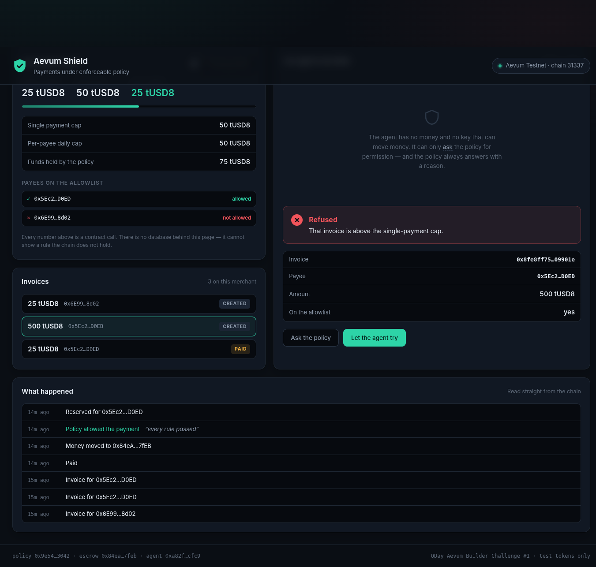

# Aevum Shield

**Payments under enforceable policy, on QDay Aevum Testnet.**

A company gives an AI agent a budget and a list of people it may pay. The
agent is wrong sometimes — confused, hijacked, or simply enthusiastic. The
question this project answers is: **what stops the agent from spending
more than it should?**

Aevum Shield's answer is that the agent never holds the money. It asks a
contract for permission, the contract reads the invoice itself and decides,
and the decision comes back as a sentence the agent can read out loud:

> That invoice is above the single-payment cap.



The refusal above is not a message from a server. It is the contract's own
reason, read from the chain.

---

## The idea in one paragraph

Three contracts, three owners, one direction of authority.

| Contract | Owner | What it can do |
| --- | --- | --- |
| `PayPolicy` | the **payer** | Holds the money. Sets the allowlist, the caps, the pause. Decides whether an invoice may be paid. |
| `InvoiceEscrow` | the **merchant** | Holds a merchant's funds. Writes invoices. Releases them once the dispute window has passed. |
| `PaymentAgent` | nobody | Holds nothing. Has no key. Its only power is to ask the policy to approve an invoice. |

The agent is an **operator** on the policy. Being an operator means it may
ask for a payment. It does not mean it may set the rules — every rule
change is owner-gated, and the owner is the payer.

The invoice's payee, amount and deadline are read from the escrow, never
from the caller. A compromised agent cannot describe a different payee to
the policy than the one the money will actually reach, because it does not
get to describe anything.

---

## Why this is not a wallet with a spending limit

A wallet with a spending limit trusts the thing holding the limit. If the
agent's key is the wallet's key, a prompt injection is a financial event.

Here the agent's key is worth nothing on its own:

- it cannot raise the caps,
- it cannot add a payee,
- it cannot take ownership,
- it cannot sweep the payer's funds,
- it cannot pull a reservation that was not made for it.

Every one of those is refused **by the chain**, not by the application.
`app/agent.mjs` tries all of them on every run and reports what happened:

```
  PASS  Raise its own spending caps
         the chain refused it: OwnableUnauthorizedAccount (0x3C44CdDdB6a900fa2b585dd299e03d12FA4293BC)
  PASS  Add a payee to the allowlist
         the chain refused it: OwnableUnauthorizedAccount (0x3C44CdDdB6a900fa2b585dd299e03d12FA4293BC)
  PASS  Take ownership of the policy
         the chain refused it: OwnableUnauthorizedAccount (0x3C44CdDdB6a900fa2b585dd299e03d12FA4293BC)
  PASS  Sweep the payer’s funds to itself
         the chain refused it: OwnableUnauthorizedAccount (0x3C44CdDdB6a900fa2b585dd299e03d12FA4293BC)
  PASS  Trust a new escrow
         the chain refused it: OwnableUnauthorizedAccount (0x3C44CdDdB6a900fa2b585dd299e03d12FA4293BC)
```

The first four are the same error: the agent is not the owner. That is the
whole design in one line.

---

## The five rules the policy enforces

1. **Allowlist** — a payee must be on the list. Set by the payer.
2. **Single-payment cap** — no one payment may exceed it.
3. **Per-payee daily cap** — a total per payee per UTC day.
4. **Daily cap** — a total per UTC day, across all payees.
5. **Pause** — the payer's kill switch. It stops new approvals and traps
   nothing: a paused policy can still release expired reservations and
   sweep unreserved funds.

Each operator also has its own cap, so one agent cannot use the whole
company's budget.

The daily counters are **UTC day buckets**, not rolling 24-hour windows.
"50 tUSD8 a day" should mean a day, and a user should be able to say when
it ends. A payment at 23:59 and another at 00:01 can therefore both pass
— that is a deliberate choice, and it is listed under the accepted risks in
the [threat model](docs/THREAT_MODEL.md).

---

## The two workflows

### Paying

```
merchant                payer / policy                 agent
   │                          │                          │
   │ createInvoice(payee,     │                          │
   │   amount, deadline)      │                          │
   │─────────────────────────>│                          │
   │                          │                          │
   │                          │   check(escrow, id)      │
   │                          │<─────────────────────────│
   │                          │   "allowed" / a reason   │
   │                          │─────────────────────────>│
   │                          │                          │
   │                          │   approve(escrow, id)    │
   │                          │<─────────────────────────│
   │                          │   reserve the budget     │
   │                          │                          │
   │   pay(id, policy)        │                          │
   │<─────────────────────────│  pull(id, escrow)        │
   │                          │  money moves, once       │
   │                          │                          │
   │   ... dispute window ...  │                          │
   │                          │                          │
   │   settle(id)             │                          │
   │─────────────────────────>│  money moves to payee    │
```

Two properties of this shape are worth naming.

**The budget is spent at approval, not at settlement.** Two approvals
racing against the same cap cannot both pass, because the second one sees
the first one's spend.

**Authorisation is a per-invoice reservation, not an ERC-20 allowance.**
An allowance is keyed by `(owner, spender)`, so approving a second invoice
for the same merchant would overwrite the first one's allowance and the
first invoice would silently become unpayable. The tests found this. The
reservation design replaced it.

### Disputing

The dispute window starts when the **payment arrives**, not when the invoice
was written. Otherwise a merchant could write an invoice early and settle
the instant the money landed, and the payer would never get a chance to
object.

Within the window, the payer may refund. A refunded payment still counts
against the budget — the money was committed and it was spent.

---

## Running it

### Locally, in one command

You need [Foundry](https://getfoundry.sh) and Node 20+.

```bash
git clone https://github.com/llakterian/aevum-shield.git
cd aevum-shield
./script/local-up.sh
```

That starts anvil, deploys the three contracts, wires them up, creates
three invoices and starts the demo on **http://localhost:8080**.

The three invoices are there to show three different outcomes:

| Invoice | Outcome |
| --- | --- |
| 25 tUSD8 to an allowed payee | **Paid.** The money moves. |
| 500 tUSD8 to an allowed payee | **Refused.** Above the single-payment cap. |
| 25 tUSD8 to an unknown payee | **Refused.** That payee is not on the allowlist. |

### Running the attack harness

```bash
cd app
source /tmp/opencode/app-env.sh
node agent.mjs
```

Twelve attempts against the deployed policy — every one of them a real call
or a real transaction. The exit code is 0 when the policy behaved as it
promises and 1 when it did not, so it works as a check.

### The tests

```bash
forge test
```

53 tests, including three fuzz invariants that run 512 cases each:

- the policy never overspends its daily cap,
- no invoice can be paid twice,
- the escrow's balance only ever changes by the exact amount of an invoice.

### On Aevum Testnet

```bash
export DEPLOYER_PRIVATE_KEY=0x...      # a funded Aevum wallet
export TUSD8=0x456569838f1d43009A91ebA4263147Afd7233483
export PAYEE=0x...                     # the payee to allow
export FUNDING_TUSD8=100                # how much tUSD8 to put in the policy

forge script script/Deploy.s.sol:Deploy \
  --rpc-url https://rpc-test.qday.info --broadcast
```

The three roles can be three different keys — `PAYER_KEY`,
`MERCHANT_KEY`, `AGENT_KEY`. Each role's setup is sent by that role's own
key, because every one of those calls is owner-gated. If you leave them
unset, the deployer's key plays all three parts, which is convenient for a
testnet demo and wrong for anything else.

Then point the demo at it:

```bash
cd app
export AEVUM_RPC_URL=https://rpc-test.qday.info
export AEVUM_CHAIN_ID=44005
export TUSD8=0x456569838f1d43009A91ebA4263147Afd7233483
export ESCROW=0x... POLICY=0x... AGENT=0x...
export DEPLOYER_PRIVATE_KEY=0x...
npm install
npm start
```

---

## A note on the hardfork

Aevum's node rejects the Cancun-only opcodes. Compiling for Cancun makes
`solc` emit `MCOPY` for ordinary memory copies and `TSTORE` for transient
storage, so a Cancun build of these contracts fails at deployment with
`invalid opcode: TSTORE`.

This project compiles for **Shanghai**, which the official
`qday-io/aevum-starter-kit` also does. There is a test in the repository
history that demonstrates the difference: the same probe contract built
for Cancun is rejected by Aevum, and the Shanghai build of the same
contract is accepted.

---

## Layout

```
src/
  PayPolicy.sol          the control plane: allowlist, caps, pause, reservations
  InvoiceEscrow.sol      the merchant's side: invoices, payment, dispute, settlement
  PaymentAgent.sol       the agent: asks, and explains
  interfaces/             the two interfaces the contracts talk through
  mocks/MockToken.sol     a six-decimal ERC-20 stand-in for tUSD8

test/
  AevumShield.t.sol       53 tests, including three fuzz invariants

script/
  Deploy.s.sol            deploy to Aevum Testnet
  Local.s.sol             deploy to a local chain, with three separate roles
  Live.s.sol              the live demonstration, in three steps
  local-up.sh             one command: chain, contracts, demo

app/
  server.mjs              reads the policy off the chain; serves the demo
  agent.mjs               the attack harness
  public/                 the interface

docs/
  THREAT_MODEL.md         what is protected, who is trusted, and what is not
  images/demo.png         the demonstration
```

---

## Technologies

- **Solidity 0.8.35**, compiled for Shanghai, on Foundry 1.7.
- **OpenZeppelin Contracts v5.7.0** — `Ownable2Step`, `ReentrancyGuard`,
  `SafeERC20`.
- **forge-std v1.17.0** — the test harness and the fuzzing.
- **viem 2.x** — the demo server and the agent harness.
- **Node 20+**, no framework. The server is one file and the interface is
  three.

---

## Licence

MIT. See [LICENSE](LICENSE).

The challenge requires attribution for reused snippets. Nothing was copied
from another project; the two dependencies are vendored as git submodules
and credited in [NOTICE](NOTICE).

## Status

This is a testnet build. It has not been audited, and the
[threat model](docs/THREAT_MODEL.md) says so plainly, along with the
eight residual risks it accepts and what would close each one.
